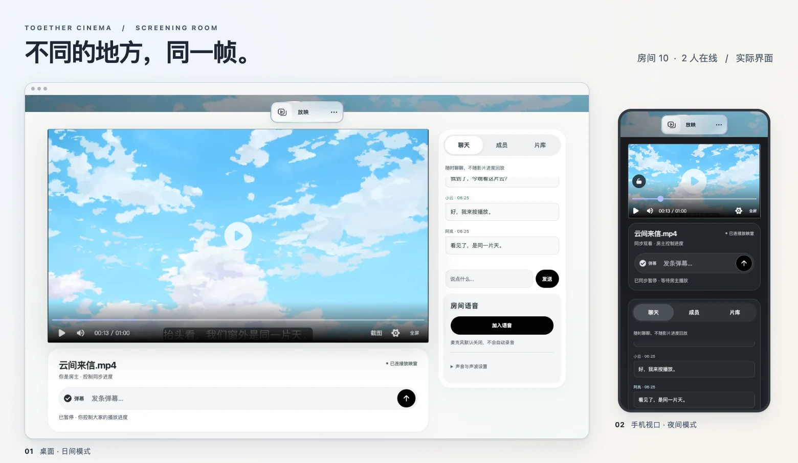
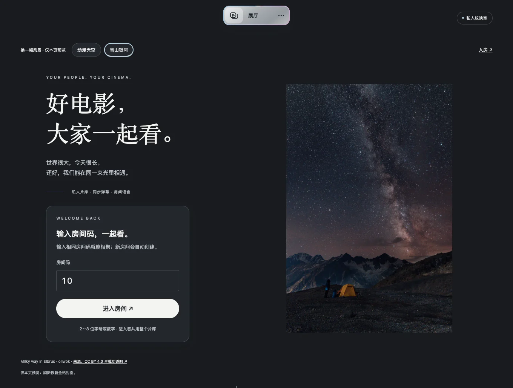
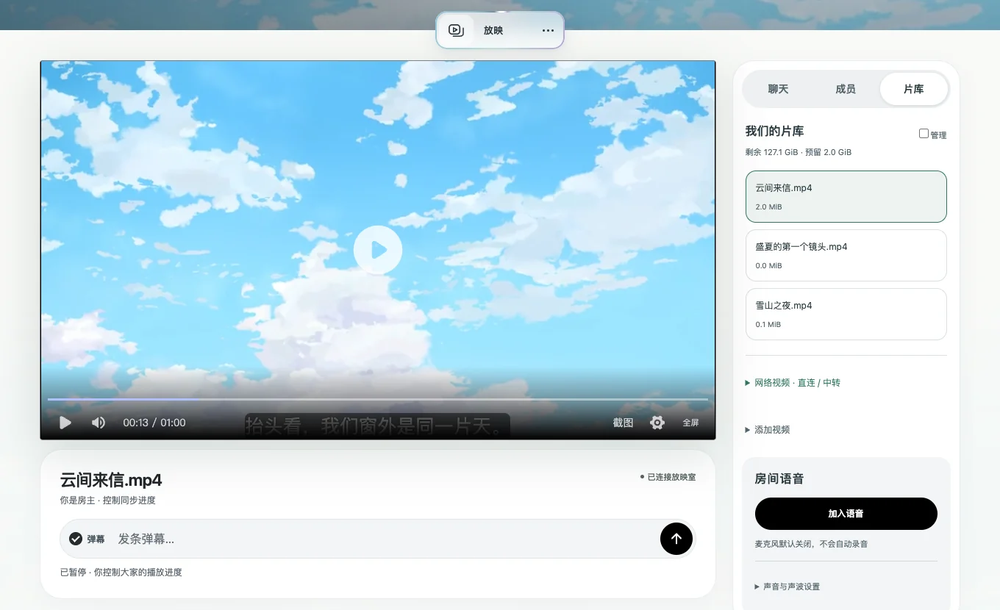
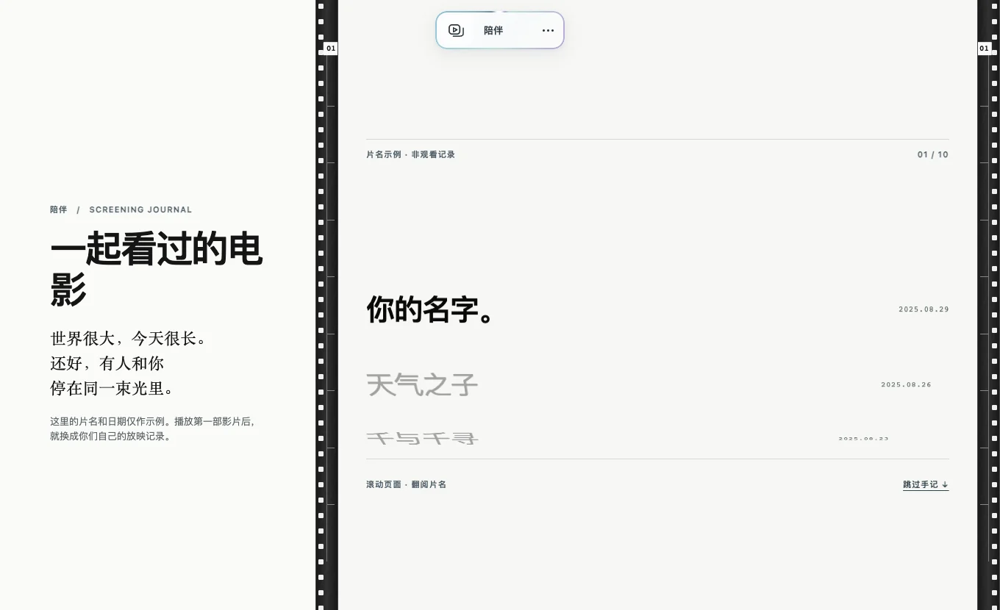
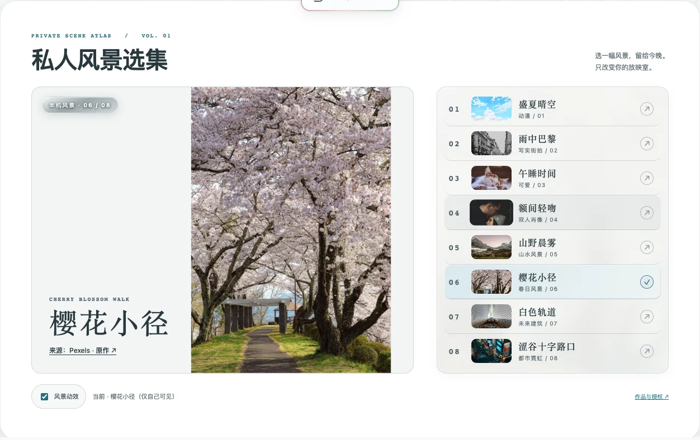

# Together Cinema

[](LICENSE)
[](https://github.com/liu-qingyuan/together-cinema/releases/latest)
[](https://github.com/liu-qingyuan/together-cinema/actions/workflows/ci.yml?query=branch%3Amain)
[](docs/deployment.md)
[](https://github.com/liu-qingyuan/together-cinema/issues/new/choose)
[](https://github.com/liu-qingyuan/together-cinema/releases.atom)
[](https://github.com/liu-qingyuan/together-cinema/commits/main.atom)

[Latest stable release](https://github.com/liu-qingyuan/together-cinema/releases/latest) · [Current architecture: control and media paths](docs/architecture/current.en.md)

**Different places. The same moment.** A self-hosted watch-party space: synchronized playback, a shared library, text chat, optional WebRTC voice, subtitles and lightweight scenes.

[中文 README](README.md) · [Deployment](docs/deployment.md) · [Security](SECURITY.md)

[20-second walkthrough](docs/showcase/tour.webp) · [Start with Docker](#start) · [Screenshot tour](docs/showcase/README.md)

[](docs/showcase/README.md)

One friend paused the film at 00:13; both screens stopped on the same frame. [Desktop view](docs/showcase/desktop.webp) · [Mobile view](docs/showcase/mobile.webp)

| Enter a room | Choose a film beside the player |
| --- | --- |
| [](docs/showcase/entry.webp) | [](docs/showcase/library.webp) |
| **Browse the screening journal** | **Choose your personal scenery** |
| [](docs/showcase/journal.webp) | [](docs/showcase/scenes.webp) |

[See the full walkthrough, including people, subtitles and artwork credits →](docs/showcase/README.md)

## Start

Install Docker Engine/Desktop with Compose v2, download this source, then:

```sh
./install.sh
```

Open **http://127.0.0.1:8080**. Enter a 2–8 character alphanumeric room code. The default listener is local-only. First builds download dependencies and may take several minutes.

For a public server, point DNS at it and open TCP80/443:

```sh
./install.sh --domain cinema.example.com
```

The HTTPS gateway requires username `cinema` and your generated `SITE_PASSWORD` in private `.env`. A room code is **not authorization**: anyone admitted to this trusted-friends deployment can view, upload and delete the entire shared library. Never expose the unprotected application port publicly.

Optional dynamic-page / YouTube extraction:

```sh
./install.sh --network
```

The optional extractor is single-job, 35s-timeout and512MiB-limited. It uses a temporary sandboxed browser, does not download complete movies, and reuses a bounded16MiB HLS cache. It does not bypass login, CAPTCHA or DRM and cannot support every website. Relay egress is still per viewer.

```sh
./install.sh --check
./uninstall.sh                    # stop, preserve media and .env
./uninstall.sh --purge-data --yes  # PERMANENTLY delete project data volumes
```

No automatic backups or global Docker prune. Updating source and rerunning the installer rebuilds the app; do this after viewing, because active room connections can be interrupted. Enable HTTPS and configure an external TURN server for reliable cross-network voice; see deployment docs.

## Features and limits

- Local MP4/WebM; background MKV/AVI processing prioritizes compatible video remuxing, otherwise bounded conversion.
- Text and supported PGS subtitles; stage fullscreen keeps subtitle/danmaku overlays.
- Sync play/pause/seek/rate, hold-to-speed-up, keyboard control, shared danmaku and room chat.
- Eight personal room wallpapers from credited illustrators and photographers, with source links; no external image CDN or analytics.
- This is an early open-source project with published source releases. [GitHub Releases](https://github.com/liu-qingyuan/together-cinema/releases) is the source of truth for versions and changes; the text link and badge above point to the latest stable release, even if badge images do not load. An Android Quark half-covered video report is unresolved; device emulation is not real-device certification.
- No prebuilt application images on Docker Hub/GHCR or public demo are provided. The installer uses Compose to build application images locally from the downloaded source; a source release is not a prebuilt application image.

## Contributing

Start with the [current code map](docs/code-map.md) for playback, library, conversion, network sources and screening history, with their tests. Tests and subtitle fixtures live together in `tests/`, without test-layer subdirectories. Use Python 3.13, `pip install -r requirements.txt`, system `ffmpeg`/`ffprobe`, then run the unchanged `python -m unittest discover -v` from the repository root. Read [CONTRIBUTING.md](CONTRIBUTING.md), [SECURITY.md](SECURITY.md), [compatibility](docs/compatibility.md) and [release checklist](docs/releasing.md).

Only use media you are authorized to access and share. MIT for original code/artwork; dependencies and runtimes retain their [own licenses](THIRD_PARTY_NOTICES.md).
