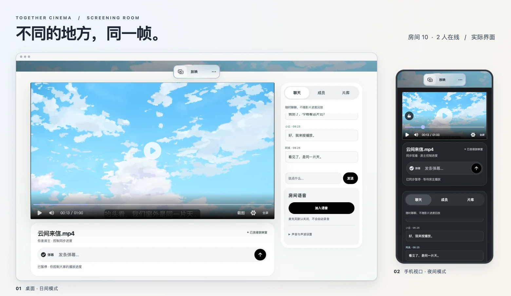
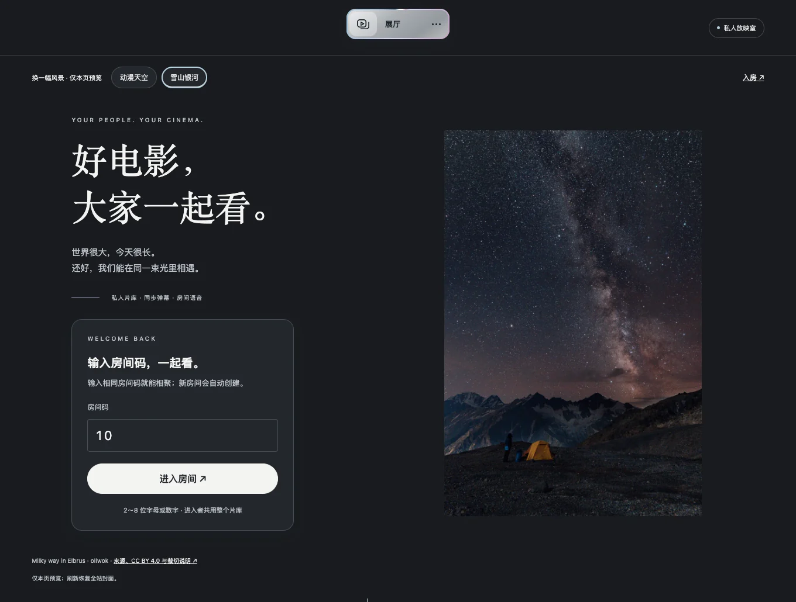
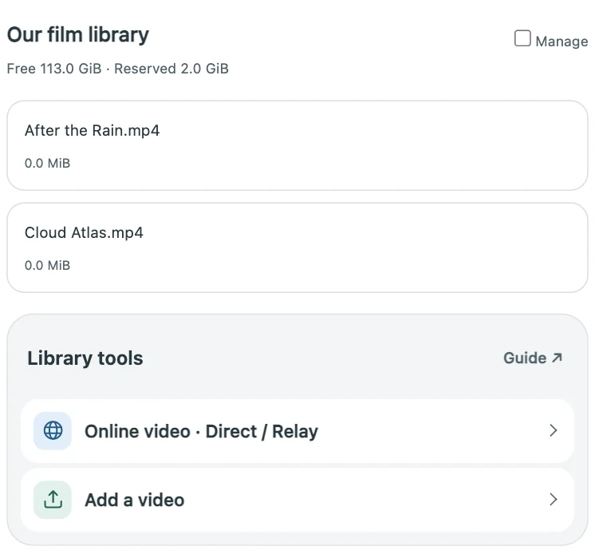
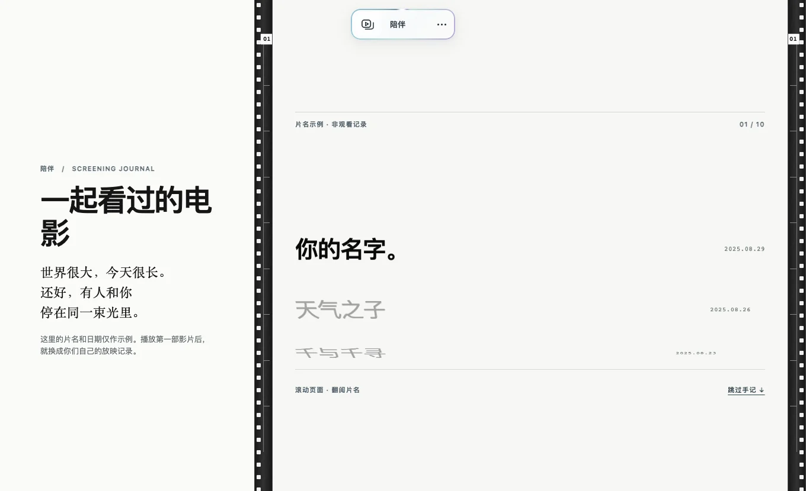
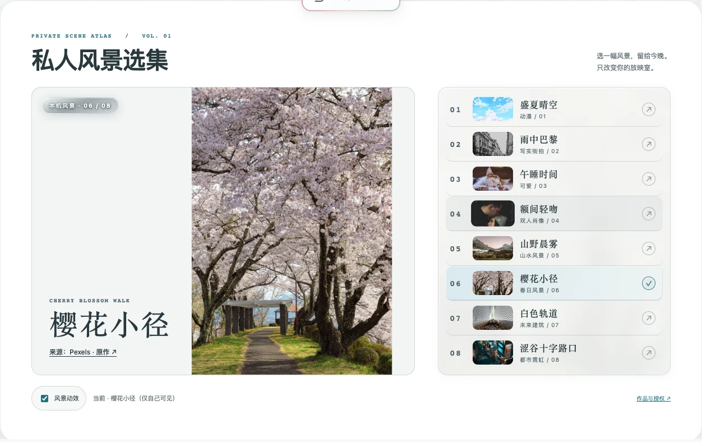

# Together Cinema

[English](README.md) · [简体中文](README.zh-CN.md)

**[Project website](https://liu-qingyuan.github.io/together-cinema/)** · **[Host your own](https://liu-qingyuan.github.io/together-cinema/deploy/en.html)** · [Viewer guide](https://liu-qingyuan.github.io/together-cinema/help/en.html)

[Latest stable release](https://github.com/liu-qingyuan/together-cinema/releases/latest) · [Current architecture: control and media paths](docs/architecture/current.en.md)

**Different places. The same moment.** A self-hosted watch-party space: synchronized playback, a shared library, text chat, optional WebRTC voice, subtitles and personal scenery.

[20-second walkthrough](docs/showcase/tour.webp) · [Host your own cinema](https://liu-qingyuan.github.io/together-cinema/deploy/en.html) · [Join a friend's invitation (no Docker)](https://liu-qingyuan.github.io/together-cinema/help/en.html#start)

One friend paused the film at 00:13; both screens stopped on the same frame. [Desktop view](docs/showcase/desktop.webp) · [Mobile view](docs/showcase/mobile.webp). These are real browser captures with Chinese UI; the current app also offers English, selected locally in Viewing settings. A mobile viewport is not a physical-phone test.

| Enter a room | Choose a film beside the player |
| --- | --- |
|  |  |
| **Browse the screening journal** | **Choose your personal scenery** |
|  |  |

[Upload progress and voice settings: see the screenshots](https://liu-qingyuan.github.io/together-cinema/#room-tools).

[Full screenshot tour and artwork credits (Chinese, with English scene headings) →](docs/showcase/README.md). Journal titles and dates in that empty-room capture are explicitly built-in examples, not real viewing history.

## Getting started

- **Hosting?** Follow the [Docker deployment guide](https://liu-qingyuan.github.io/together-cinema/deploy/en.html): install locally, enable HTTPS, verify playback, and upgrade while keeping your media. Images are built on your host.
- **Invited?** Open your friend’s link; no Docker or extension is needed. The [viewer guide](https://liu-qingyuan.github.io/together-cinema/help/en.html) covers choosing a film, subtitles, sync, and [direct vs. relay](https://liu-qingyuan.github.io/together-cinema/help/en.html#modes).

Room codes do not isolate the library. Use protected HTTPS and invite only people you trust: admitted members can upload and delete films. Use only media you have permission to share.

[Contribute](CONTRIBUTING.md) · [Architecture](docs/architecture/current.en.md) · [Compatibility](docs/compatibility.md) · [Security](SECURITY.md) · [Releases](https://github.com/liu-qingyuan/together-cinema/releases)

Original code: [MIT](LICENSE). Third-party media and libraries retain [their own licenses](THIRD_PARTY_NOTICES.md).
