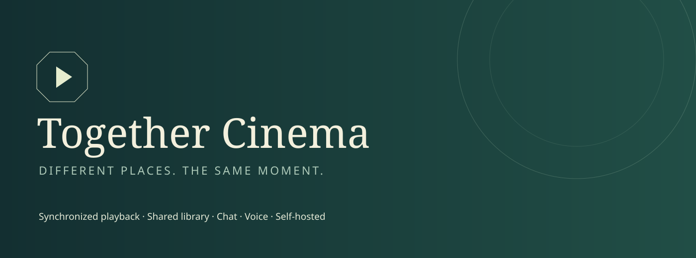

<p align="center"></p>

<p align="center"><b>一起看，把同一段时光留给彼此。</b><br>Self-hosted watch parties with synchronized playback, a shared library, chat and optional voice.</p>

<p align="center"><a href="README.en.md">English</a> · <a href="#快速开始">快速开始</a> · <a href="docs/deployment.md">部署</a> · <a href="SECURITY.md">安全边界</a> · <a href="docs/compatibility.md">兼容性</a></p>

## 它适合谁？

想和朋友远程一起看片，但不想把电影交给第三方平台的人。影片放在自己的服务器，房间进度自动同步，边看边聊天；动态背景、字幕和控制界面属于同一个放映空间。

- **同步不止播放键**：播放／暂停、拖动、倍速、长按快进、键盘控制、弹幕和多人房间。
- **自己的共享片库**：上传 MP4 / WebM；MKV / AVI 自动处理，优先保留兼容视频编码，后台完成后入库；支持删除。
- **保留字幕**：文字字幕，以及受支持的 PGS 图片字幕；全屏包含字幕和弹幕。不是任意 MKV／字幕编码的通用解码器。
- **聊天与语音**：房间文本聊天；配置 TURN + HTTPS 后可使用 WebRTC 语音、音量控制与声波显示。
- **可选网络片源**：直连或服务器中转；启用 `network` 后支持 YouTube 和通用动态网页探测。不绕过登录、验证码或 DRM，不保证所有网站可用。
- **展厅与放映室**：普通入口先逛「动漫天空／雪山银河」展厅，下滑查看有权限访问的片库；房间邀请经校验直达放映室。展厅保留当前封面，放映室不显示共享封面管理面板。顶部预设按钮仍只作本页预览；放映室另有八款来自作者作品页的高清私人壁纸，显示署名与原作入口。展厅素材随部署提供、按视口选尺寸，控制区支持静态不透明回退，入房后停止装饰动效。浏览时不请求第三方图片 CDN 或统计脚本。

## 快速开始

准备好 **Docker Engine / Docker Desktop + Compose v2**。首次构建需要联网下载依赖，耗时取决于网络，首次耗时不作保证。

下载／克隆本项目，进入目录后执行：

```sh
./install.sh
```

打开 **http://127.0.0.1:8080** 先浏览展厅，再输入 2～8 位字母或数字房间码进入放映室。朋友可使用房间里复制的 `/?room=AB` 邀请直接会合，无需先逛展厅。普通入口即使记住了上次房间也不会自动入房；无授权会话时不展示私人片单。默认仅本机访问，不是公网发布。

### 给异地朋友使用

先把域名 DNS 指向服务器，开放 TCP 80/443：

```sh
./install.sh --domain cinema.example.com
```

浏览器会先要求网站用户名 **`cinema`** 和 `.env` 中自动生成的 **`SITE_PASSWORD`**，再进入房间码页面。只有这个 HTTPS 入口适合直接暴露公网；不要把应用的 8080 端口无保护地转发到公网。

> **房间码不是密码。** 当前是“受信任好友共享片库”模型：进入任意房间的访客都能上传、观看、删除整个片库，不能拿它当多租户公共视频网站。公开入口需要额外访问保护，详见 [SECURITY.md](SECURITY.md)。

### 启用动态网页与 YouTube 解析

```sh
./install.sh --network
# 或初次安装就一起开启
./install.sh --network --domain cinema.example.com
```

解析容器的浏览器镜像较大，只在启用后下载／构建。一次一个任务，35秒超时、512MiB容器上限，临时浏览器在结束／失败后退出；HLS共享分片缓存限制16MiB，避免整部影片落盘。它节省相同分片的原站请求，**不减少每位观众的服务器出口流量**。

## 安装之后

```sh
./install.sh --check                 # 只检查配置
./install.sh --port 8088             # 更改本机端口
# 升级：先查看变更，再更新源码并重建
# git pull --ff-only && ./install.sh
./uninstall.sh                       # 停止容器，保留影片和配置
./uninstall.sh --purge-data --yes     # 永久删除本项目数据卷和证书！
```

安装不自动导出或下载备份，不删除其他 Docker 项目，不执行全局 prune。重复安装保留 `.env` 中的密钥和媒体数据卷。升级过程会短暂重建应用连接，请等大家看完再操作；房间状态不保证跨重启保存。

## 你需要多少资源？

| 模式 | 建议起点（不是基准测试承诺） | 注意 |
|---|---|---|
| 本地视频／聊天 | 1 vCPU、1GiB RAM，建议2GiB | FFmpeg转换和大文件上传会额外占资源 |
| 加动态解析 | 建议2GiB RAM以上 | 解析前检查可用内存，单次浏览器上限512MiB |
| 磁盘 | 系统、镜像之外留出影片和转换空间 | 默认保留2GiB空闲作为写盘保护；这不是预占文件 |

视频码率和人数决定带宽。源码不会让33GB原片自动变成低流量；上传转码策略、最高分辨率和浏览器解码支持见部署文档。

## 项目状态

这是从私人使用版本整理出的**首个开源候选版本**。它不是已验证所有网站、所有手机、任意公网网络的成品 SaaS。安卓夸克收到过半屏黑色遮挡反馈，尚未完成实机复现，见 [兼容性说明](docs/compatibility.md)。不把浏览器模拟通过当作实机认证。

本仓库目前不提供已发布 Docker Hub/GHCR 镜像或在线公开演示；从源码构建即可使用。远程仓库地址和发布版本由维护者确认后添加，不伪造 star、下载量或 CI 通过徽章。

## 开发与贡献

```sh
python3 -m venv .venv
. .venv/bin/activate
pip install -r requirements.txt
# 测试依赖系统 ffmpeg / ffprobe
python -m unittest discover -v
```

可选的真实浏览器验收（需本机 Chrome、系统 ffmpeg 和专用本地 Compose 测试实例）：

```sh
pip install playwright
python scripts/gallery_smoke.py http://127.0.0.1:8080
# 使用 Playwright Chromium 时先 playwright install chromium，再加 --channel chromium
# 可加 --artifacts /tmp/gallery-evidence 保存截图，不保存 Cookie 或会话
```

脚本用两个独立浏览器进程检查两条入口、片库权限和真实同步播放，只上传／删除自己生成的测试短片。

两种展厅预设、资源按需加载、焦点和偏好回退可额外验证：

```sh
python scripts/gallery_visual_smoke.py http://127.0.0.1:8080 --artifacts /tmp/gallery-visual
```

请在专用本地 Compose 实例运行；连续重复入房测试可能触发原有登录限流，等待窗口或仅重启专用测试实例后再跑。手机尺寸模拟不代表手机实机验收；[当前画面与真机验收缺口](docs/gallery-visual-acceptance.md)。

[贡献指南](CONTRIBUTING.md) · [架构](docs/architecture.md) · [发布检查](docs/releasing.md) · [第三方授权](THIRD_PARTY_NOTICES.md)

欢迎小而完整的修复、可重复的兼容性报告和文档改进。请只分享你有权观看和分发的内容；本项目不附带影片、会员资源或第三方站点账号。

## License

项目原创代码和矢量背景采用 [MIT](LICENSE)。两套展厅图片为署名保留的 **CC BY 4.0** 作品，不改标 MIT。第三方图片、库及运行时授权详见 [THIRD_PARTY_NOTICES.md](THIRD_PARTY_NOTICES.md)。
