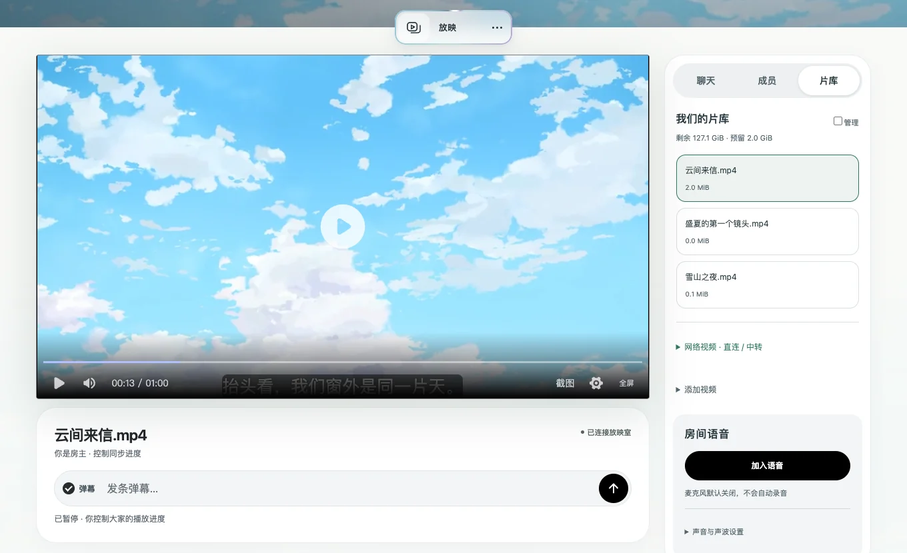

# Together Cinema · 一起看

[English](README.md) · [简体中文](README.zh-CN.md)

**[项目介绍网站](https://liu-qingyuan.github.io/together-cinema/zh-CN/)** · [观众指南](https://liu-qingyuan.github.io/together-cinema/help/zh-CN.html)

[](LICENSE)
[](https://github.com/liu-qingyuan/together-cinema/releases/latest)
[](https://github.com/liu-qingyuan/together-cinema/actions/workflows/ci.yml?query=branch%3Amain)
[](docs/deployment.md)
[](https://github.com/liu-qingyuan/together-cinema/issues/new/choose)
[](https://github.com/liu-qingyuan/together-cinema/releases.atom)
[](https://github.com/liu-qingyuan/together-cinema/commits/main.atom)

[最新正式发行](https://github.com/liu-qingyuan/together-cinema/releases/latest) · [现行架构：同步控制与媒体流](docs/architecture/current.md)

**不同的地方，同一场电影。** 和朋友同步播放、边看边聊，把一起看过的片留成一本放映手记。

[看 20 秒演示](docs/showcase/tour.webp)　·　[自己部署](#快速开始)　·　[加入朋友的邀请（无需 Docker）](#加入邀请)

[](docs/showcase/README.md)

**同一进度，不同习惯。** 上图是两个真实浏览器会话：房主在桌面暂停《云间来信》，手机视口也停在同一幕。[桌面原图](docs/showcase/desktop.webp) · [手机原图](docs/showcase/mobile.webp)。这些是中文界面的实际截图，手机尺寸为桌面浏览器视口模拟，不是真机认证；当前界面也可在观影设置中切换英文。

| 入房：输入房间码，和朋友会合 | 选片：片库就在播放器旁边 |
| --- | --- |
| [](docs/showcase/entry.webp) | [](docs/showcase/library.webp) |
| **陪伴：沿着胶片翻看放映记录** | **风景：换一幅只属于自己的背景** |
| [](docs/showcase/journal.webp) | [](docs/showcase/scenes.webp) |

[继续看：开场大图、房间成员、夜间字幕设置与素材署名 →](docs/showcase/README.md)

## 它适合谁？

想和朋友远程一起看片，但不想把电影交给第三方平台的人。影片放在自己的服务器，房间进度自动同步，边看边聊天；动态背景、字幕和控制界面属于同一个放映空间。

- **同步不止播放键**：播放／暂停、拖动、倍速、长按快进、键盘控制、弹幕和多人房间。
- **自己的共享片库**：上传 MP4 / M4V / WebM；MKV / AVI 自动处理，优先保留兼容视频编码，后台完成后入库；支持删除。
- **保留字幕**：文字字幕，以及受支持的 PGS 图片字幕；全屏包含字幕和弹幕。不是任意 MKV／字幕编码的通用解码器。
- **聊天与语音**：房间文本聊天；配置 TURN + HTTPS 后可使用 WebRTC 语音、音量控制与声波显示。
- **可选网络片源**：直连或服务器中转；可启用 `network` 来探测动态网页中的可播放视频。不绕过登录、验证码或 DRM，不保证所有网站可用。
- **展厅与放映室**：普通入口先逛「动漫天空／雪山银河」展厅，下滑查看有权限访问的片库；房间邀请经校验直达放映室。展厅保留当前封面，放映室不显示共享封面管理面板。顶部预设按钮仍只作本页预览；放映室另有八款来自作者作品页的高清私人壁纸，显示署名与原作入口。展厅素材随部署提供、按视口选尺寸，控制区支持静态不透明回退，入房后停止装饰动效。浏览时不请求第三方图片 CDN 或统计脚本。

## 快速开始

**路径一：自己部署。** 只来观影的朋友请直接看[加入邀请](#加入邀请)，不必安装以下工具。

准备好 **Docker Engine / Docker Desktop + Compose v2**（支持 `up --wait`）。首次构建需要联网下载依赖，耗时取决于网络，首次耗时不作保证。检查 `docker context show`，确认使用的是预期引擎；安装器不自动 sudo、不安装 Docker、不修改防火墙。

本页的双语界面与指南步骤对应**当前 `main` 源码**，不保证旧发行归档包含这些功能。安装 Git 后克隆主分支：

```sh
git clone https://github.com/liu-qingyuan/together-cinema.git
cd together-cinema
./install.sh
```

不使用 Git 时，下载[当前 main 源码压缩包](https://github.com/liu-qingyuan/together-cinema/archive/refs/heads/main.zip)，解压进入目录后只运行 `./install.sh`，不用再克隆。选择正式发行则以该版本的 README 和变更说明为准。打开 **http://127.0.0.1:8080** 先浏览展厅，再输入 2～8 位字母或数字房间码进入放映室；新码建房，相同码进同一房间。默认仅本机访问，不是公网发布。普通入口即使记住了上次房间也不会自动入房；无授权会话时不展示私人片单。

### 给异地朋友使用

先把域名 DNS 指向服务器，开放 TCP 80/443：

```sh
./install.sh --domain cinema.example.com
```

打开 `https://cinema.example.com`（换成实际域名），浏览器会先要求网站用户名 **`cinema`** 和 `.env` 中自动生成的 **`SITE_PASSWORD`**，再进入房间码页面。`WATCH_PASSWORD` 是内部签名／解析密钥，不是站点访问密码。Compose 健康不保证 DNS 已传播或证书已签发，必要时查看 `docker compose logs --tail=100 https`。只有这个 HTTPS 入口适合直接暴露公网；不要把应用的 8080 端口无保护地转发到公网。

> **房间码不是密码。** 当前是“受信任好友共享片库”模型：进入任意房间的访客都能上传、观看、删除整个片库，不能拿它当多租户公共视频网站。只邀请信任的人；不要分享 `.env` 或公开私人邀请。公开入口需要额外访问保护，详见 [安全边界（英文）](SECURITY.md)。

### 视频解析

在片库输入公开的视频网页或 HTTPS 媒体地址，选择直连或服务器中转，再从候选中选片。以下命令仅用于启用动态网页探测；媒体直链不需要这个可选组件。

```sh
./install.sh --network
# 或初次安装就一起开启
./install.sh --network --domain cinema.example.com
```

解析容器的浏览器镜像较大，只在启用后下载／构建。一次一个任务，35 秒超时、512 MiB 容器上限，临时浏览器在结束／失败后退出；HLS 共享分片缓存限制 16 MiB，避免整部影片落盘。它节省相同分片的原站请求，**不减少每位观众的服务器出口流量**。本地文件、公开 HTTPS 媒体直链和可发现媒体的静态网页不需要动态解析容器；不开启也能首次观影。

## 加入邀请

**路径二：受邀观众，无需 Docker 或浏览器插件。**

1. 向部署者索取完整邀请，例如 `https://cinema.example.com/?room=AB`（示例域名，不是在线演示）。打开朋友的实际链接，若站点弹出登录框，使用部署者给的站点用户名 `cinema` 和访问密码，不是第三方网站账号。
2. 有效邀请直接进入对应放映室；没有邀请则打开朋友的站点，输入同一个 2～8 位字母／数字房间码。核对双方房号和在线人数。
3. 界面语言默认跟随浏览器的中文／英文，无匹配回退简中；可在「观影设置 → 界面语言」选「简体中文」。只影响本浏览器，不改朋友的界面或翻译片名、聊天、字幕。

## 选片与确认同步

部署者与受邀者入房后走同一条路径：

1. 先进入的人通常是房主，以「你是房主」提示为准。需要时在「成员 → 接管播放控制」接管；由房主选片、播放、暂停、拖动和改同步倍速，其他观众跟随。
2. 点击「向下进入放映」，打开侧栏「片库」。房主先暂停当前影片，再点已有影片；空片库用「添加视频」上传自己有权共同播放的 MP4 / M4V / WebM / MKV / AVI。MKV / AVI 等后台处理完成才入库，留意处理状态及空间。
3. 两端核对片名，房主按播放；若浏览器阻止声音，每个人先点击播放器播放按钮允许发声。让房主暂停再续播，确认双方跟随；未同步时检查房号与连接状态，断线点「重连」。音量、字幕和弹幕显示各自选择。
4. 想看网络片源？在「片库 → 网络视频 · 直连 / 中转」粘贴有权使用的公开视频网页或 HTTPS 媒体地址，选择模式后点「解析视频」，**明确点击对应候选**才切片。双视频网页要按顺序和画面选第二段，不会自动选第一条；换模式需重新解析并重新选同一段。

**直连**让每位观众向原站取媒体（HLS 入口清单仍经本站），要求每个人可达且浏览器支持；**中转**由服务器合法取流并分别发送。默认选项为中转；大家都可达原站时建议先改直连。默认中转额度全站共享 **5 GiB / 24 小时**、最多 **6 个并发媒体请求**，不是 6 位观众保证；共享缓存不免除每人的出口流量。片源临时存在，不永久入库。不绕过登录、付费、验证码或 DRM，不保证所有网站／编码可用。

[中文观众指南](https://liu-qingyuan.github.io/together-cinema/help/zh-CN.html)可直接在线阅读，无需入房或输入口令。每个自建站也附带 `/help/zh-CN.html`，访问自建站时仍遵循该站的密码设置。展厅和片库里的「使用指南」会在新标签页打开，不打断播放。指南说明直连与中转的选择，以及无候选、片源过期和额度不足时的处理。

## 安装之后

```sh
./install.sh --check                 # 只检查配置
./install.sh --port 8088             # 更改本机端口
# 升级：先查看变更，再更新源码并重建
# git pull --ff-only && ./install.sh
./uninstall.sh                       # 停止容器，保留影片和配置
./uninstall.sh --purge-data --yes     # 永久删除本项目数据卷和证书！
```

安装不自动导出或下载备份，不删除其他 Docker 项目，不执行全局 prune。重复安装保留 `.env` 中的密钥和媒体数据卷。Git 克隆可按上述 `git pull --ff-only` 升级；源码压缩包用户先备份，再把新版源码更新到原目录，保留私有 `.env` 与相同 Compose 项目名／数据卷，重跑 `./install.sh`，不要另建空片库。升级过程会短暂重建应用连接，请等大家看完再操作；房间状态不保证跨重启保存。

语音需 HTTPS；在私有 `.env` 填写与外部 TURN 服务匹配的 `WATCH_TURN_URLS` 和 `WATCH_TURN_SECRET`，再运行 `./install.sh`。未配 TURN 时界面提示语音未启用，文本聊天仍可用；本项目不自动安装 TURN，也不保证穿透所有网络。详见[部署与 TURN 参考](docs/deployment.md)，首次文字聊天共看不需要这一步。

使用版本化镜像和 Nginx 静态首页的生产站点，请走[生产发布流程（英文）](docs/releasing.md#versioned-production-releases-linux-compose--nginx)：先验收隔离片库和公网实际解码，再回收本次构建缓存及无引用的上一版镜像。普通安装器不会清理宿主机。

## 你需要多少资源？

| 模式 | 建议起点（不是基准测试承诺） | 注意 |
|---|---|---|
| 本地视频／聊天 | 1 vCPU、1GiB RAM，建议2GiB | FFmpeg转换和大文件上传会额外占资源 |
| 加动态解析 | 建议2GiB RAM以上 | 解析前检查可用内存，单次浏览器上限512MiB |
| 磁盘 | 系统、镜像之外留出影片和转换空间 | 默认保留2GiB空闲作为写盘保护；这不是预占文件 |

视频码率和人数决定带宽。源码不会让 33 GB 原片自动变成低流量。兼容的 H.264 可能只换封装／转音轨，不会无损变小；其他受支持且需转码的视频按现有策略最高 720p。当前 H.265/HEVC 自动处理可能因输出检查失败而无法入库，首次观影建议先在本机转为 SDR H.264/AAC MP4，不承诺任意编码上传成功。上传时保持页面打开，分片上传不是跨刷新续传；详见[部署中的存储与转换参考](docs/deployment.md)。

## 项目状态

这是从私人使用版本整理出的早期开源项目，**源码已发布**，版本和变更以 [GitHub Releases](https://github.com/liu-qingyuan/together-cinema/releases) 为准，顶部文字入口与版本徽章指向最新正式发行，图片不可见时仍可通过文字查看发行信息。它不是已验证所有网站、所有手机、任意公网网络的成品 SaaS。安卓夸克收到过半屏黑色遮挡反馈，尚未完成实机复现，见 [兼容性说明（英文）](docs/compatibility.md)。不把浏览器模拟通过当作实机认证。

本项目目前不提供应用的预构建 Docker Hub/GHCR 镜像或在线公开演示。安装器通过 Compose 从下载的源码本地构建应用镜像；源码发布不等于提供预构建应用镜像。

## 开发与贡献

先看[当前代码地图](docs/code-map.md)：按播放、片库、转码、网络片源和放映记录定位职责与测试。测试和图片字幕素材集中在 `tests/`，不分层级；从仓库根运行原命令：

```sh
python3 -m venv .venv
. .venv/bin/activate
pip install -r requirements.txt
# 测试依赖系统 ffmpeg / ffprobe
python -m unittest discover -v
```

可选的真实浏览器验收（需本机 Chrome、系统 ffmpeg 和专用本地 Compose 测试实例）：

```sh
pip install playwright
python scripts/gallery_smoke.py http://127.0.0.1:8080
# 使用 Playwright Chromium 时先 playwright install chromium，再加 --channel chromium
# 可加 --artifacts /tmp/gallery-evidence 保存截图，不保存 Cookie 或会话
```

脚本显式使用中文界面，用两个独立浏览器进程检查两条入口、片库权限和真实同步播放，只上传／删除自己生成的测试短片。双语界面及帮助／网络取流可另跑 `python -m scripts.locale_smoke` 与 `python -m scripts.guide_smoke`，它们自建临时本机应用和合成媒体，不连接现有部署。

两种展厅预设、资源按需加载、焦点和偏好回退可额外验证：

```sh
python scripts/gallery_visual_smoke.py http://127.0.0.1:8080 --artifacts /tmp/gallery-visual
```

请在专用本地 Compose 实例运行；连续重复入房测试可能触发原有登录限流，等待窗口或仅重启专用测试实例后再跑。手机尺寸模拟不代表手机实机验收；[历史画面与真机验收缺口](docs/gallery-visual-acceptance.md)。

[部署与维护（中文）](docs/deployment.md) · [贡献指南（英文）](CONTRIBUTING.md) · [当前代码地图（中文）](docs/code-map.md) · [历史部署迁移设计（英文）](docs/architecture.md) · [发布检查（英文）](docs/releasing.md) · [第三方授权（英文）](THIRD_PARTY_NOTICES.md)

### 双语文档维护

目前只维护简体中文与 English；README、观众指南和界面语言相互独立。修改首次观影步骤、命令、配置默认值、权限或流量限制时，同一提交同步两份 README、对应 `web/help/zh-CN.html` / `web/help/en.html` 与相关界面词条；目标是信息一致，不是逐句直译。新增译本先在 [GitHub Issues](https://github.com/liu-qingyuan/together-cinema/issues/new/choose)说明语言和持续维护者，扩展译本集中放在 `docs/readme/`，不在根目录铺设占位文件；准备完整首次观影路径及本语言截图说明，通过同一安装／邀请／选片／同步走查后再加入页首互链；不要列出空页或无人维护的译本。未译高级参考标出目标语言，不让它成为首次观影的前置条件。此次双语路径的[验证与限制（英文）](docs/readme-acceptance.md)记录了复用的检查入口。

欢迎小而完整的修复、可重复的兼容性报告和文档改进。请只分享你有权观看和分发的内容；本项目不附带影片、会员资源或第三方站点账号。

## License

项目原创代码和矢量背景采用 [MIT](LICENSE)。两套展厅图片为署名保留的 **CC BY 4.0** 作品，不改标 MIT。第三方图片、库及运行时授权详见 [THIRD_PARTY_NOTICES.md](THIRD_PARTY_NOTICES.md)。
