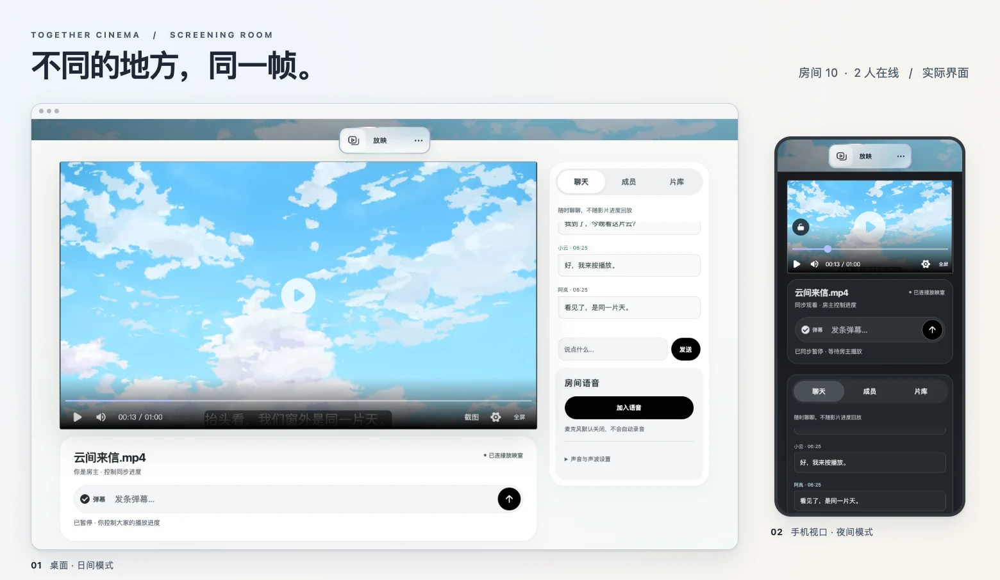
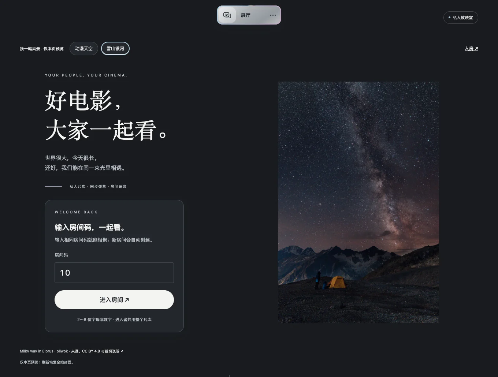
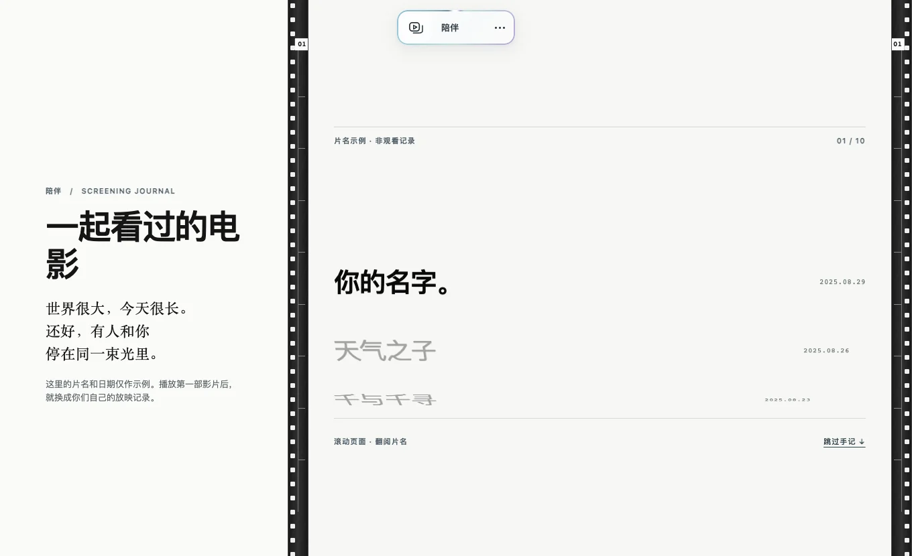
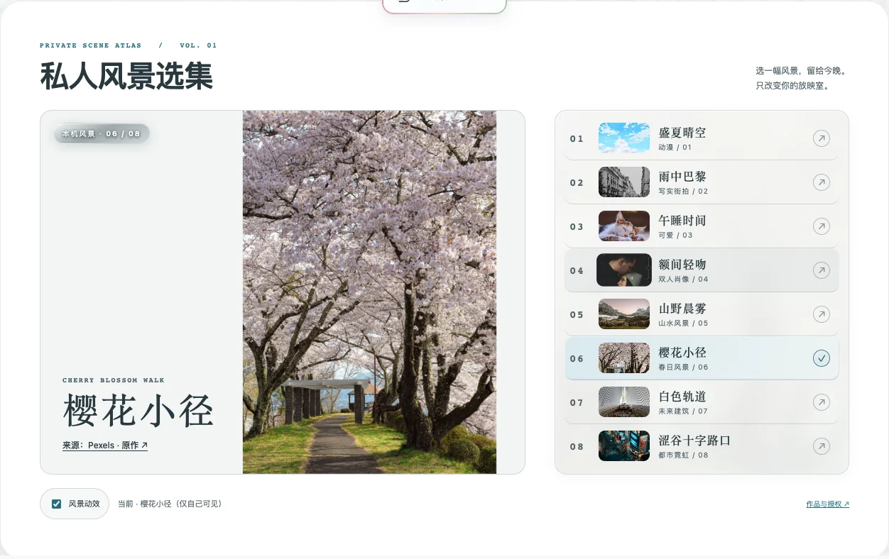

# Together Cinema · 一起看

[English](README.md) · [简体中文](README.zh-CN.md)

**[项目介绍网站](https://liu-qingyuan.github.io/together-cinema/zh-CN/)** · **[自己部署](https://liu-qingyuan.github.io/together-cinema/deploy/zh-CN.html)** · [观众指南](https://liu-qingyuan.github.io/together-cinema/help/zh-CN.html)

[最新正式发行](https://github.com/liu-qingyuan/together-cinema/releases/latest) · [现行架构：同步控制与媒体流](docs/architecture/current.md)

**不同的地方，同一场电影。** 和朋友同步播放、边看边聊，把一起看过的片留成一本放映手记。

[看 20 秒演示](docs/showcase/tour.webp)　·　[自己部署](https://liu-qingyuan.github.io/together-cinema/deploy/zh-CN.html)　·　[加入朋友的邀请（无需 Docker）](https://liu-qingyuan.github.io/together-cinema/help/zh-CN.html#start)

**同一进度，不同习惯。** 上图是两个真实浏览器会话：房主在桌面暂停《云间来信》，手机视口也停在同一幕。[桌面原图](docs/showcase/desktop.webp) · [手机原图](docs/showcase/mobile.webp)。这些是中文界面的实际截图，手机尺寸为桌面浏览器视口模拟，不是真机认证；当前界面也可在观影设置中切换英文。

| 入房：输入房间码，和朋友会合 | 选片：片库就在播放器旁边 |
| --- | --- |
|  |  |
| **陪伴：沿着胶片翻看放映记录** | **风景：换一幅只属于自己的背景** |
|  |  |

[继续看：开场大图、房间成员、夜间字幕设置与素材署名 →](docs/showcase/README.md)

## 从这里开始

- **我来搭建。** 按[部署教程](https://liu-qingyuan.github.io/together-cinema/deploy/zh-CN.html)在本机启动、配置公网 HTTPS、验证播放，并在保留片库的前提下升级。应用镜像在你自己的主机上构建。
- **朋友邀请我看。** 打开邀请链接就能入房，不用 Docker 或插件。[观众指南](https://liu-qingyuan.github.io/together-cinema/help/zh-CN.html)介绍选片、字幕、同步，以及[直连和中转怎么选](https://liu-qingyuan.github.io/together-cinema/help/zh-CN.html#modes)。

房间码不隔离片库。公网请使用受保护的 HTTPS，只邀请信任的人：获准进入的人可以上传、删除全站影片。请只分享有权限的内容。

[参与贡献](CONTRIBUTING.md) · [系统架构](docs/architecture/current.md) · [兼容性说明](docs/compatibility.md) · [安全边界](SECURITY.md) · [版本发布](https://github.com/liu-qingyuan/together-cinema/releases)

原创代码以 [MIT](LICENSE) 发布；第三方素材与库保留[各自的许可证](THIRD_PARTY_NOTICES.md)。
