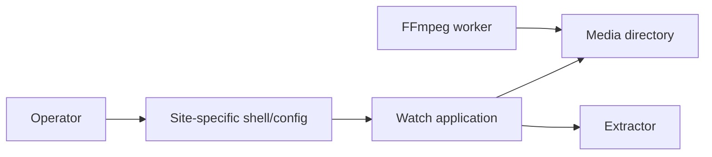
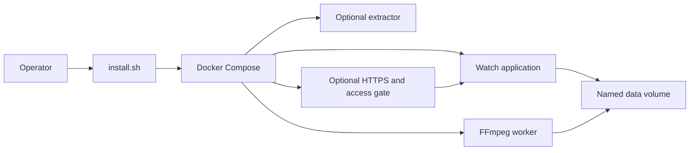
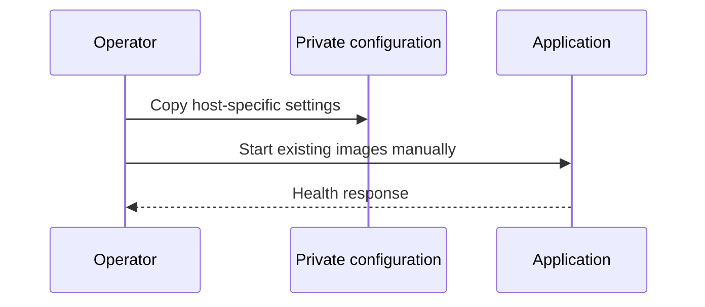
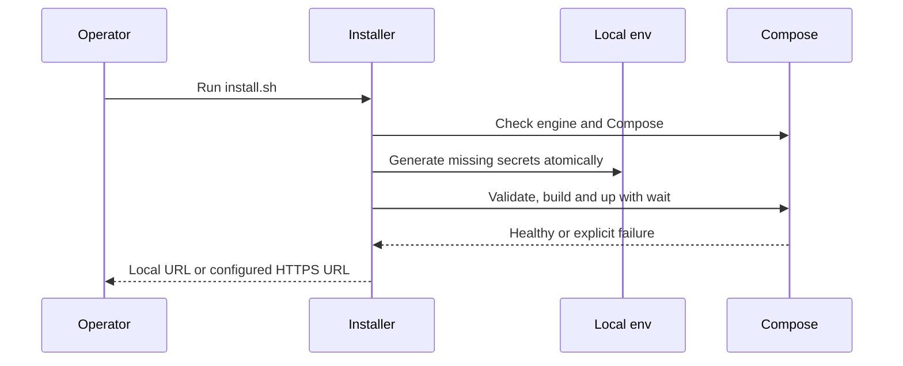
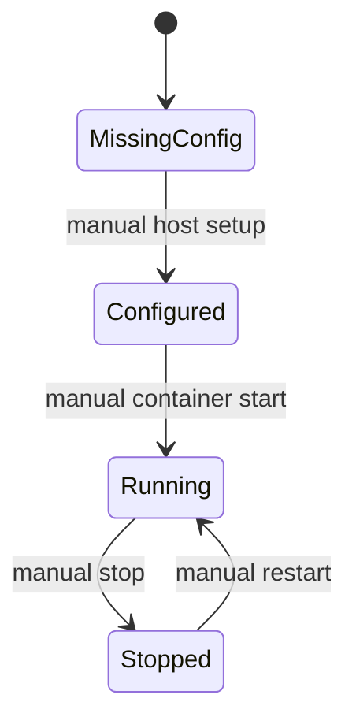
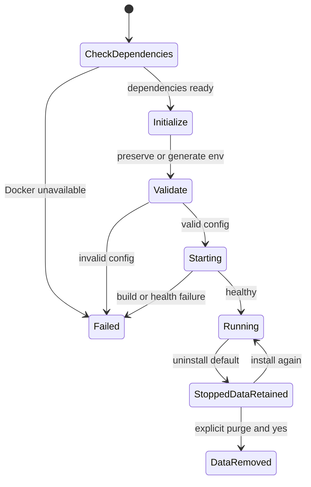
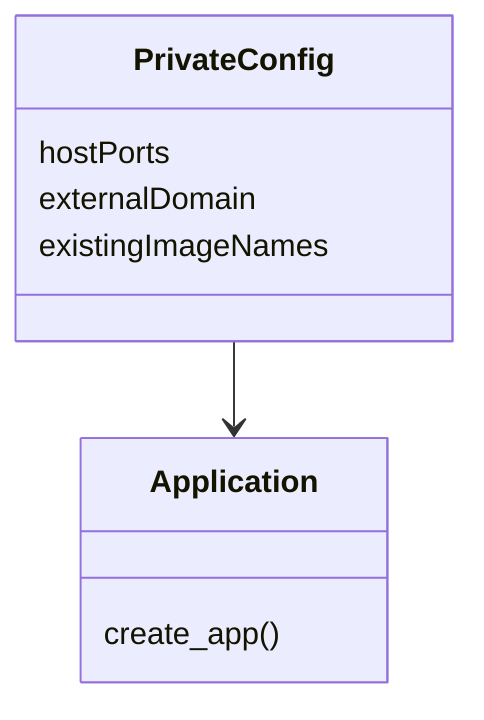
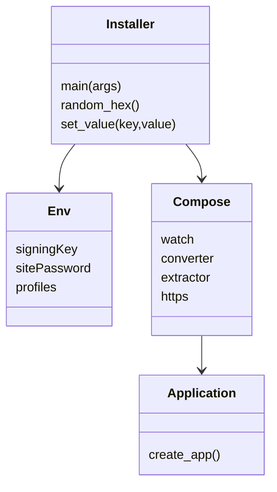

# Historical deployment design: private snapshot → distributable project

Recorded on **2026-11-23**, before the first Alpha source release. “Current” below means the private snapshot at design time; “Target” means the planned distributable deployment, not a comparison of today's code. Preserved as a migration record; use the [current code map](code-map.md) for navigation and [deployment guide](deployment.md) for operation.

Scope at the time: a new deployment Interface, original playback Module preserved. No production changes.

## Current architecture

## Target architecture

## Current sequence

## Target sequence

## Current lifecycle

## Target lifecycle

## Current ownership

## Target ownership
Shell roles below are Interface responsibilities, not newly introduced Python classes.

