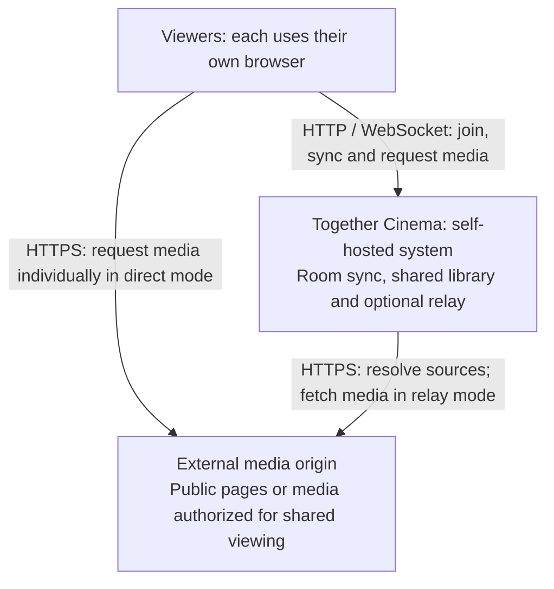
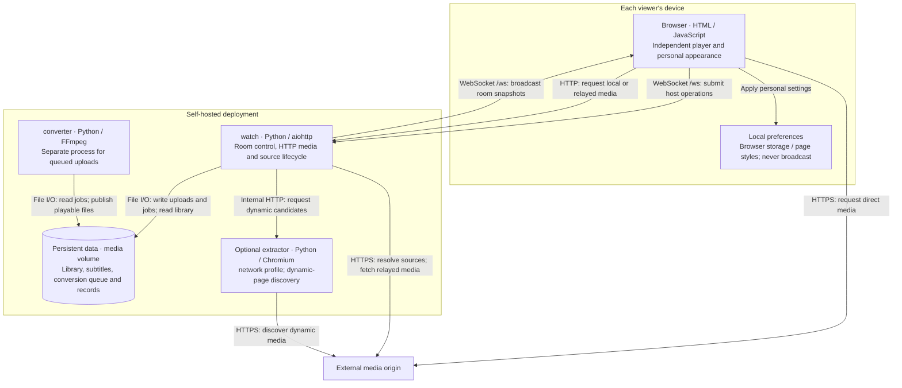

# Current architecture: control and media paths

[简体中文](current.md) · [English](current.en.md) · [Back to README](../../README.en.md)

This describes the current source, not a migration plan. **Together Cinema shares the selected source and playback state, not a screen recording. Video bytes do not travel over WebSocket.** The [current code map](../code-map.md) (Chinese) locates responsibilities and tests; the [deployment guide](../deployment.md) and [security boundary](../../SECURITY.md) cover operation and access protection.

## System context

## Runtime units and data ownership

The optional HTTPS gateway and WebRTC / TURN voice paths are omitted. Neither is a video relay or conversion worker. [Compose](../../compose.yml) defines the actual services and shared volumes.

### Four separate paths

| Path | Current behavior | Source entry points |
| --- | --- | --- |
| **Sync control** | Browsers send operations to `/ws`. The server checks the host and broadcasts source, position, pause and playback-rate snapshots. Each browser plays and corrects its own timeline. Chat and danmaku also use room messages, but video bytes do not. | [`control()` / `apply()`](../../web/index.html), [`Room` / `websocket()`](../../cinema/server.py) |
| **Media** | `watch` serves local library files at `/media/{name}`. Network sources are resolved and explicitly selected, then fetched in direct or relay mode (below). | [`setPlaybackSource()`](../../web/index.html), [`ExternalMedia`](../../cinema/external_media.py) |
| **Background conversion** | MKV / AVI uploads enter a persistent queue. The separate `converter` runs FFmpeg and publishes successful output to the library; the browser queries job status. Conversion is not part of room sync, and does not mean every format must be re-encoded. | [`publish_upload()`](../../cinema/server.py), [`enqueue()` / `work_once()` / `process_job()`](../../cinema/conversion.py) |
| **Personal preferences** | Chinese/English interface language, day/night appearance, personal scenery and subtitle/danmaku visibility affect only the local browser. Some choices persist in browser storage; brightness, contrast and text-subtitle size apply only to the current page. They do not change a friend's display. | [`locale.js`](../../web/assets/locale.js), [`appearance.js`](../../web/assets/appearance.js), [`room-atlas-v2.js`](../../web/assets/room-atlas-v2.js), [page settings](../../web/index.html) |

## Direct or relay?

The server still manages source selection and room sync in both modes. **The host's control rules do not change.**

- **Direct:** every viewer's browser requests media from the origin rather than having the cinema server forward the video. All viewers need origin access and compatible CORS/codec support. Not every request bypasses the app: resolution and source registration remain server-side; the entry HLS playlist is rewritten by the app, with media links pointing to the origin.
- **Server relay:** browsers request `/api/network/{id}/play` from the cinema server. `watch` fetches from the origin and sends media separately to each viewer. This can help when the server can reach the origin but a viewer cannot; it is not a universal fix for CORS, codec or origin restrictions.
- Eligible HLS fragments share a bounded in-memory cache. This **reduces duplicate origin requests, not server egress per viewer**. Relay concurrency, cache and traffic quotas still apply. Network films are not permanently imported into the library.
- Dynamic-page discovery requires the optional `network` profile; static public media does not always need it. No login, paywall, CAPTCHA or DRM bypass is provided, and not every URL is playable.

## Shared and persistent state

- Rooms share the source and playback state, mainly held in `watch` memory and not guaranteed to survive a restart. Screening history and danmaku are persisted separately.
- The library and gallery cover are **deployment-wide**, not private folders per room. A room code is not a password; admitted members can access and manage the shared library. Personal scenery is a local preference, not the shared gallery cover.
- `watch` and `converter` share the media volume. Background conversion and network relay are separate paths; relay does not invoke the conversion queue.

## Documentation and releases

- [Latest stable release](https://github.com/liu-qingyuan/together-cinema/releases/latest): GitHub Releases owns versions and changes; no second “latest version” number is maintained here. A source release is not a prebuilt application image.
- [Current code map](../code-map.md) (Chinese): responsibilities, entry points and tests for maintainers; this page does not duplicate the test inventory.
- [Historical deployment migration design](../architecture.md) and [first distributable version spec](../SPEC.md): their Current / Target labels refer to the design-time snapshot, not today's before/after state.
