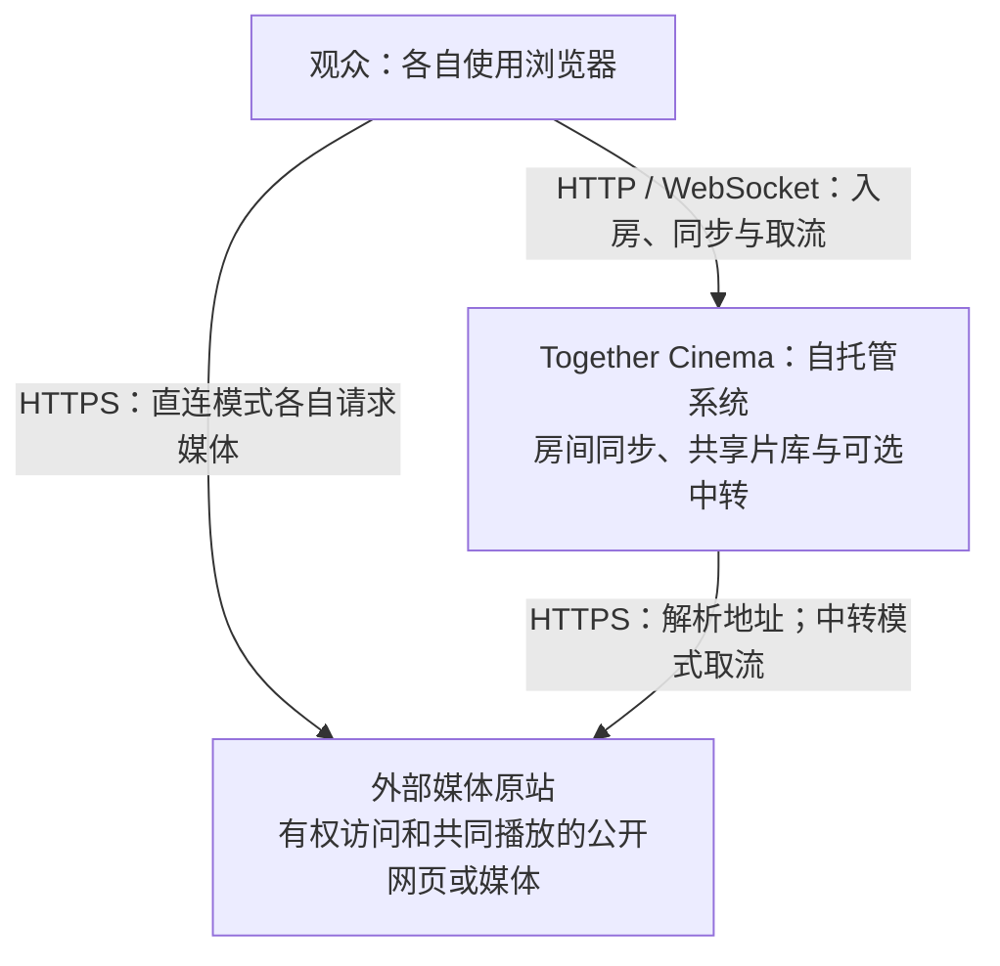
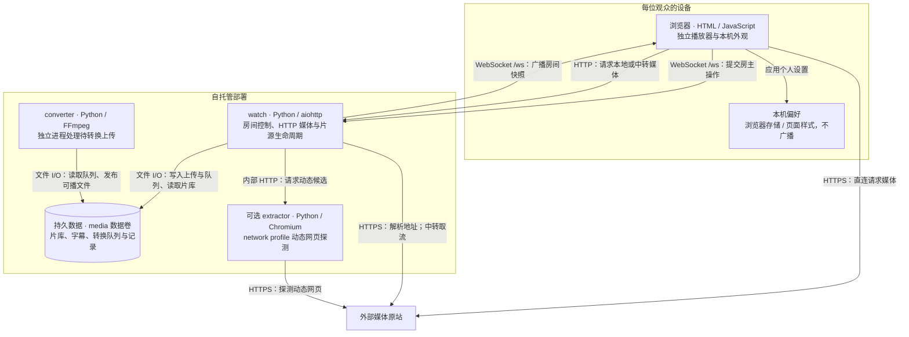

# 现行架构：同步控制与媒体流

[简体中文](current.md) · [English](current.en.md) · [返回首页](../../README.md)

这里描述当前源码，不是迁移计划。**一起看同步的是所选片源与播放状态，不是屏幕共享，也不通过 WebSocket 传输影片。** 维护者按职责找源码与测试请看[当前代码地图](../code-map.md)；部署参数与访问保护见[部署指南](../deployment.md)和[安全边界](../../SECURITY.md)。

## 谁与谁通信

## 运行单元与数据归属

图中省略了可选 HTTPS 网关与语音的 WebRTC / TURN 链路；它们不是影片中转或转换进程。实际启动单元和共享卷以 [Compose](../../compose.yml) 为准。

### 四条路径，不要混为一谈

| 路径 | 当前行为 | 源码入口 |
| --- | --- | --- |
| **同步控制** | 浏览器向 `/ws` 发送操作；服务端校验房主后广播片源、进度、暂停与倍速快照，各端自行播放并校准。聊天、弹幕也走房间消息，但影片字节不走这里。 | [`control()` / `apply()`](../../index.html)、[`Room` / `websocket()`](../../server.py) |
| **媒体流** | 本地影片由 `watch` 的 `/media/{name}` 提供；网络片源先解析并选择候选，再按直连／中转模式取流（见下）。 | [`setPlaybackSource()`](../../index.html)、[`ExternalMedia`](../../external_media.py) |
| **后台转换** | MKV / AVI 上传进入持久队列，独立 `converter` 调用 FFmpeg；成功后发布到片库，浏览器查询任务状态。转换不占用房间同步流程，也不代表所有格式都要重编码。 | [`publish_upload()`](../../server.py)、[`enqueue()` / `work_once()` / `process_job()`](../../conversion.py) |
| **个人偏好** | 日夜外观、私人风景与字幕／弹幕显示等只影响本机；部分保存在浏览器存储，亮度、对比度与文字字幕字号仅在当前页面生效。它们不会改变朋友的画面。 | [`appearance.js`](../../assets/appearance.js)、[`room-atlas-v2.js`](../../assets/room-atlas-v2.js)、[页面设置](../../index.html) |

## 直连还是中转

两种模式仍由服务器处理选片与房间同步，**都不改变房主控制规则**。

- **直连**：每位观众的浏览器向原站请求媒体，不由放映室服务器转发整段视频。所有成员都必须能访问原站，并满足浏览器的跨域与编码要求。直连不等于所有请求都绕过应用：解析与片源登记仍在服务端；HLS 的入口播放列表经应用改写，媒体链接指向原站。
- **服务器中转**：浏览器向放映室的 `/api/network/{id}/play` 请求媒体，`watch` 向原站取流后分别发送给观众。它适合服务器能取流、但某成员不能直连原站的情况；不能保证解决所有跨域、编码或原站限制。
- 合适的 HLS 分片可在服务器内存中限额共享缓存，**减少重复原站请求，不减少每位观众的服务器出口流量**。中转受并发、缓存和流量额度约束，不会把网络影片永久入库。
- 动态网页探测需启用可选 `network` profile；静态公开媒体并不总需要它。不绕过登录、付费、验证码或 DRM，也不保证任意网址都可播放。

## 共享与持久化边界

- 房间共享片源与播放状态；状态主要在 `watch` 内存中，不保证跨重启保留。放映记录和弹幕另有持久化。
- 片库与展厅封面是**全站共享**，不是各房间的私有文件夹。房间码不是密码；入房成员能访问和管理共享片库。私人风景则属于本机偏好，不能与共享封面混淆。
- `watch` 与 `converter` 共用媒体数据卷；后台转换与网络中转是不同链路，中转不调用转换队列。

## 文档与发行入口

- [最新正式发行](https://github.com/liu-qingyuan/together-cinema/releases/latest)：版本与变更由 GitHub Releases 维护；这里不另记一个“最新版本号”。源码发布不等于提供预构建应用镜像。
- [当前代码地图](../code-map.md)：维护者的职责、入口与测试导航，不在本页复制测试清单。
- [历史部署迁移设计](../architecture.md)与[首个可分发版本规格](../SPEC.md)：保留当时的 Current / Target，不代表今天的前后状态。
