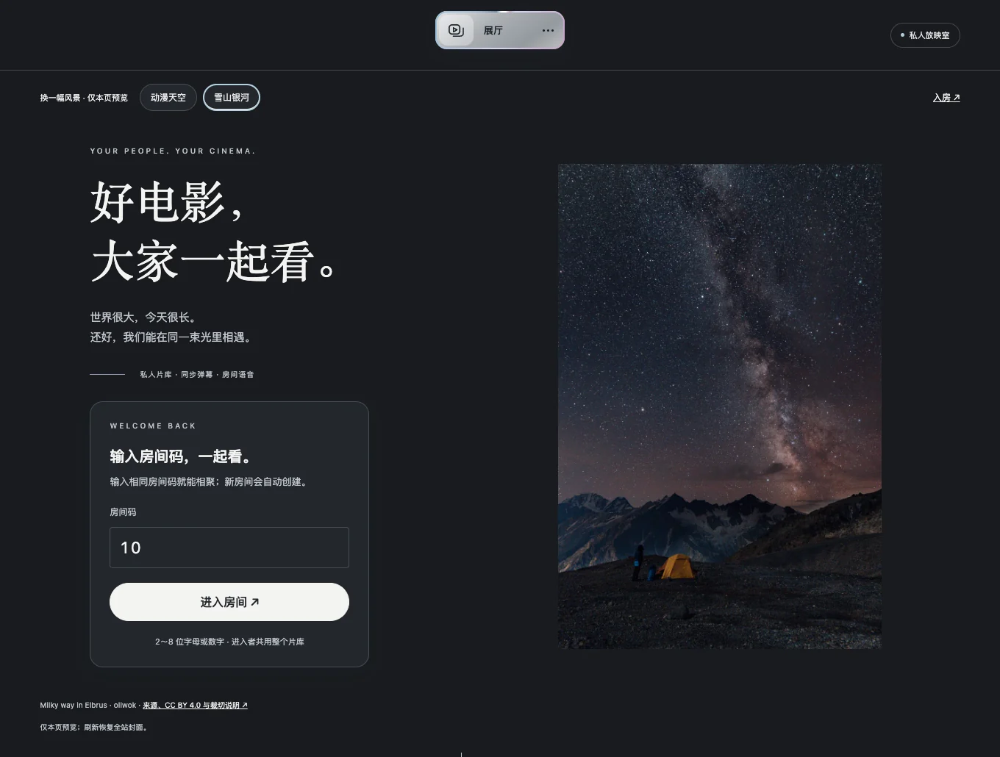
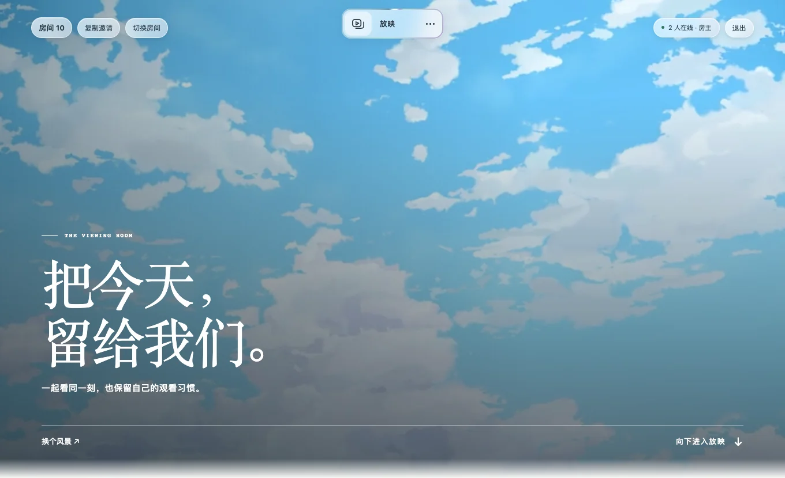
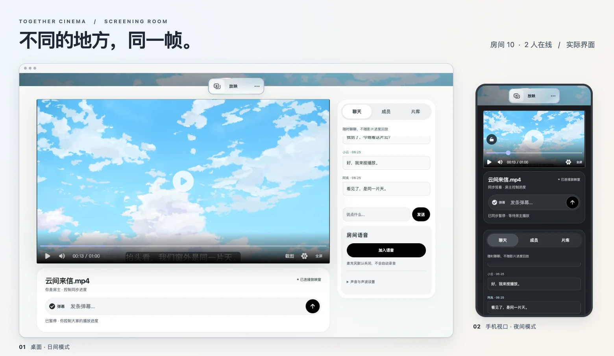
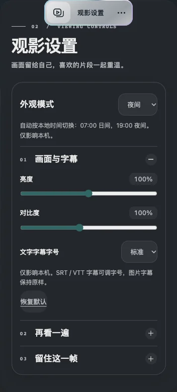
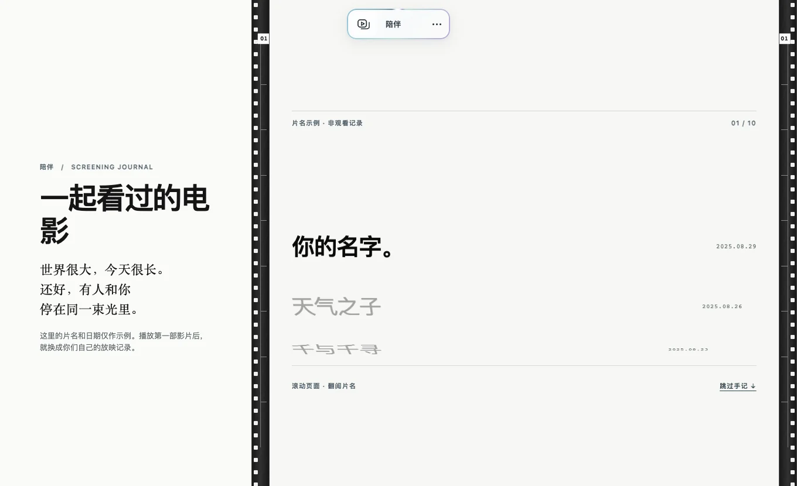
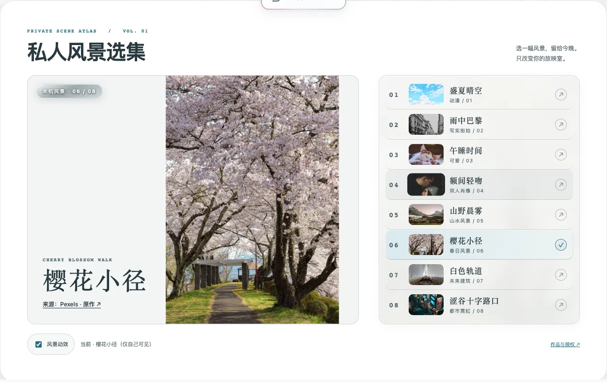

# 一间放映室，从入场到散场
**Together Cinema · A visual tour**　[中文首页](../../README.md) · [English](../../README.en.md) · [20 秒动态演示 / 20-second tour](tour.webp)

这些是同一版网页的实际截图，不是设计稿。桌面和手机视口使用两个独立的浏览器会话；示例影片、昵称、聊天都只存在于本地演示环境。手机视口由 Chrome 模拟，不代表手机真机兼容性测试。

Captured from the running app in a local demo, using two independent browser sessions. The mobile view is a Chrome viewport capture, not a physical-device test.

### 01　入场 / Enter the room

朋友可以输入同一个房间码，也可以点邀请直接进房。房间码用来会合，不是公网访问密码。

Join with a shared room code or open an invitation directly.

### 02　开场 / Before the film

风景铺满第一屏，往下才到播放器。开场和影片是两回事：更换风景不会切换房间正在看的片。

Scroll past the scenery to the player. A personal scene choice never changes the shared film.

### 03　同步放映 / Two screens, one film

房主暂停时，两边都停在《云间来信》的第 13 秒。左边保持日间、右边切到夜间，不影响共同进度。

The host paused the demo film at 00:13. Both sessions show that moment, with independent appearance settings.

[桌面放映与聊天 / Desktop and chat](desktop.webp) · [手机纵向全图 / Mobile close-up](mobile.webp)

### 04　片库 / Pick a film

把右栏从「聊天」切到「片库」就能选下一部，不必离开放映室。这里的短片均为演示素材。

The shared library opens beside the player, without leaving the room.

### 05　成员与观影习惯 / Shared room, personal controls

| 房间成员 / People | 观影设置 / Viewing preferences |
| --- | --- |
|  |  |
| 查看谁在房间、谁是房主；语音需要主动加入。 | 亮度、对比度和文字字幕字号只影响自己的画面。 |
| See who is present and who controls playback. Voice is opt-in. | Adjust the picture and text subtitles on your own screen. |

### 06　陪伴 / Screening journal

下滑切换片名，两侧的齿孔跟着走。图中是**空房间的内置示例**；房间第一次实际放映后，才开始用自己的片名和日期替代它们。

The filmstrip follows your scroll. This view shows the built-in examples, not anyone’s private viewing history.

### 07　私人风景 / Your scenery

在八种风景间切换。你这里是樱花小径，另一端仍可以是盛夏晴空。

Pick one of eight scenes without changing anyone else’s backdrop.

**素材 / Credits.** 演示短片《云间来信》使用 Unicorn Creates 的 [Sky Backgrounds](https://unicorncreates.itch.io/sky-backgrounds) 裁切、推镜并循环；雪山展厅摄影为 oliwok 的 [Milky way in Elbrus](https://commons.wikimedia.org/wiki/File:Milky_way_in_Elbrus.jpg)。两者均为 [CC BY 4.0](https://creativecommons.org/licenses/by/4.0/)。樱花照片及列表缩略图的原作、作者与许可见[第三方素材说明](../../THIRD_PARTY_NOTICES.md#personal-room-wallpapers)。截图与动态演示保留网页中的构图与字幕；双端首图另加设备边框及说明。第三方作品不因出现在截图中而改为 MIT。
